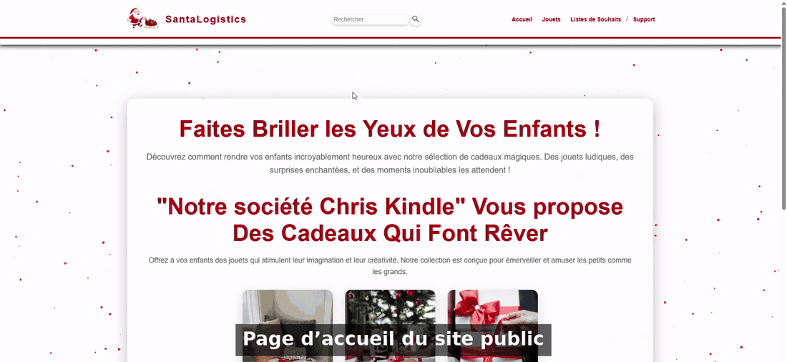

# SantaLogistics — Gestion des commandes et de la logistique de Noël

Application web universitaire développée en **PHP et Oracle SQL**, avec une interface **HTML, CSS et JavaScript**. SantaLogistics relie les souhaits des enfants aux données de fabrication et de distribution des jouets : ateliers, équipes, matières premières, entrepôts et livraisons.

Le projet a été développé et exécuté dans l’environnement universitaire de l’UPJV, avec une base Oracle.

## Aperçu



## Fonctionnalités

- **Catalogue public** : consultation des jouets, recherche et création d’une liste de souhaits.
- **Commandes de jouets** : consultation, filtre par date, ajout et suppression depuis l’espace administrateur.
- **Gestion des ressources** : formulaires de gestion des enfants, elfes, rennes, ateliers, entrepôts, équipes, chefs d’équipe, remplacements et matières premières. Les opérations proposées dépendent de la rubrique.
- **Suivi logistique** : consultation des cadeaux, fournisseurs, spécialités, substitutions de jouets, itinéraires, traîneaux et livraisons.
- **Suivi de fabrication** : consultation de l’historique, des commandes de matières premières et des jouets confiés aux sous-traitants.
- **Comptes administrateurs** : inscription avec un code privé, connexion, modification du profil et suppression du compte.

## Technologies et organisation

| Élément | Rôle |
|---|---|
| PHP et extension OCI8 | Traitements serveur, sessions et accès à Oracle |
| Oracle SQL | Modèle relationnel de 28 tables, clés étrangères, contraintes et données d’exemple |
| HTML, CSS et JavaScript | Interfaces, formulaires, navigation et animations |
| `public_html/` | Pages publiques, espace administrateur `a/`, styles, scripts et images |
| `public_html/includes/` | En-têtes, pieds de page, fonctions, sessions et contrôles d’accès |
| `public_html/connexion-base/` | Chargement de la configuration et connexion Oracle |
| `bd.sql` | Création des tables et insertion de 194 lignes d’exemple |
| `drop.sql` | Suppression des tables du projet — efface leurs données |
| `config.example.php` | Modèle de configuration locale, sans identifiants personnels |

## Installation locale

### 1. Préparer l’environnement

Il faut **PHP 8.1 ou supérieur**, l’extension **OCI8**, les bibliothèques clientes Oracle compatibles avec l’installation PHP et une **base Oracle accessible**. Un outil comme SQL Developer ou SQL*Plus permet d’exécuter le script SQL.

Ce projet utilise Oracle : importer `bd.sql` dans MySQL ne suffit pas. GitHub héberge les sources ; GitHub Pages n’exécute ni PHP ni Oracle.

Vérifier PHP et OCI8 :

```bash
php -v
php --ri oci8
```

### 2. Initialiser la base

Dans un **schéma Oracle dédié et vide**, disposant des droits de création de tables et d’un quota de stockage, exécuter `bd.sql` avec SQL Developer en mode script, ou avec SQL*Plus :

```sql
@bd.sql
```

Les données fournies servent à la démonstration. Aucun compte administrateur par défaut n’est créé.

`drop.sql` ne sert qu’à réinitialiser volontairement les tables : **ne pas l’exécuter sur une base contenant des données à conserver**.

### 3. Renseigner la configuration

Copier `config.example.php` en **`config.local.php` à la racine**, à côté du README. Compléter :

- `host` : adresse, port et service Oracle, par exemple `localhost:1521/FREEPDB1` ;
- `user` et `password` : identifiants de votre schéma Oracle ;
- `registration_code` : un code privé de votre choix, nécessaire à la création des comptes administrateurs.

Le fichier `config.local.php` reste **hors de `public_html/`** et est exclu du dépôt par `.gitignore`. Ne pas publier ce fichier, même lors d’un téléversement manuel sur GitHub.

Les variables d’environnement `ORACLE_HOST`, `ORACLE_USER`, `ORACLE_PASSWORD` et `SANTA_REGISTRATION_CODE` peuvent remplacer les valeurs du fichier.

### 4. Démarrer l’application

Depuis la racine du projet :

```bash
php -S localhost:8000 -t public_html
```

- Catalogue : <http://localhost:8000/>
- Création du compte administrateur : <http://localhost:8000/a/inscription.php>
- Connexion : <http://localhost:8000/a/compte.php>
- Tableau de bord : <http://localhost:8000/a/>

Créer un compte avec le code privé configuré et un mot de passe de **8 à 64 caractères**. Le serveur intégré PHP est destiné aux essais locaux.

## Parcours d’utilisation

1. Consulter le catalogue et rechercher un jouet.
2. Renseigner les informations d’un enfant et enregistrer sa liste de souhaits.
3. Se connecter à l’espace administrateur pour consulter les commandes et gérer les ressources.
4. Consulter le suivi de fabrication, globalement ou en filtrant par jouet ou par enfant.

## Principes techniques

- Modèle relationnel reliant les commandes aux ressources de fabrication et de distribution.
- Requêtes SQL paramétrées avec OCI8.
- Sessions et contrôle d’accès aux pages de gestion.
- Mots de passe hachés et protection des formulaires par jetons CSRF.
- Enregistrement transactionnel des listes de souhaits : validation complète ou annulation en cas d’erreur.
- Configuration de connexion séparée du code publié.

### Compatibilité avec une installation existante

**Ne pas réinitialiser une base existante.** Les anciens comptes SHA-256 restent reconnus, y compris les anciens mots de passe contenant des caractères échappés par l'application. Les nouveaux mots de passe utilisent bcrypt (60 caractères), compatible avec la colonne `CHAR(64)` d'origine : aucune migration de cette colonne n'est nécessaire.

La fonction de connexion conserve `oci_connect` et l'encodage `AL32UTF8`. Si `config.local.php` est absent, elle peut réutiliser le fichier privé d'origine `public_html/connexion-base/my-param.inc.php` et ses constantes `MYHOST`, `MYUSER` et `MYPASS`. Ce fichier n'est volontairement pas fourni dans le dépôt et ne doit jamais être publié. Le conserver dans l'installation existante permet de garder ses paramètres Oracle. Pour autoriser de nouvelles inscriptions, définir un code privé dans `SANTA_REGISTRATION_CODE` ou dans la nouvelle configuration. 

## Périmètre du projet

Application académique de démonstration. Certaines rubriques proposent des opérations de gestion, d’autres sont en consultation seule. La liste de souhaits publique repose sur un identifiant enfant, sans compte individuel : les démonstrations doivent utiliser des données fictives.

L’exécution nécessite un environnement PHP/OCI8 relié à Oracle et sa configuration privée. Les icônes du tableau de bord sont chargées depuis le CDN Font Awesome.
